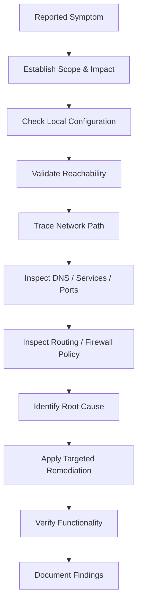
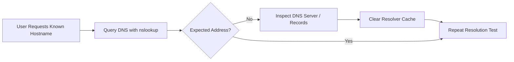
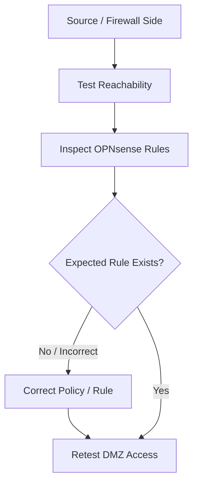

# Enterprise Network Troubleshooting & Diagnostics

[](https://github.com/montezguido/enterprise-network-troubleshooting/actions/workflows/verify-triage.yml)

## Recruiter quick start — independent, executable Python

This repository preserves a sanitized WGU troubleshooting case study **and** contains a separate, independently written [network-triage exercise](portfolio_demo/README.md) with fictional observations. Run with Python 3.11+ from the repository root:

```bash
python portfolio_demo/triage.py
python -m unittest discover -s tests -v
```

[Python source](portfolio_demo/triage.py) · [Six synthetic cases](portfolio_demo/sample_cases.json) · [28 regression tests](tests/test_triage.py) · [Evidence map](docs/evidence-map.md) · [Cross-platform CI](.github/workflows/verify-triage.yml)

The tool suggests candidate fault domains and next diagnostic steps; it **does not capture traffic, probe real networks, change devices, or prove a root cause**. The completed academic cases are historical experience, while the runnable Python and CI results are separate evidence of independently developed software.

---

## Original WGU troubleshooting case study

## Overview

This repository presents a sanitized hands-on network troubleshooting case study built around six different failure and security scenarios. The work focuses on systematic diagnosis rather than guesswork: establish the symptom, narrow the scope, gather evidence with the appropriate tool, isolate the root cause, apply a targeted correction, and verify the result.

The scenarios cover packet analysis, DNS resolution, routing, endpoint addressing, firewall policy, service exposure, and general connectivity troubleshooting across Windows, Linux, and network-security environments.

> **Project scope:** troubleshooting methodology and technical case analysis. Institution-provided ticket text, screenshots, assessment prompts, and restricted lab artifacts are intentionally not reproduced here.

---

## Troubleshooting Methodology



The exact order changes depending on the symptom. The key principle is to move from broad evidence to increasingly specific evidence while avoiding unnecessary configuration changes before the fault domain is understood.

---

## Diagnostic Toolkit

| Tool / Command | Primary Use in the Case Study |
|---|---|
| Wireshark | Packet-capture inspection and suspicious traffic analysis |
| PCAP analysis | Protocol and conversation-level investigation |
| `ping` | Basic IP reachability testing |
| `traceroute` / `tracert` | Path analysis and routing fault isolation |
| `nslookup` | DNS query validation and name-resolution troubleshooting |
| `ipconfig /all` | Windows addressing, gateway, and DNS configuration review |
| Linux DNS/service utilities | Resolver cache and DNS-service troubleshooting |
| `ss -tuln` | TCP/UDP listening-port enumeration |
| OPNsense | Firewall-rule and DMZ access troubleshooting |

---

# Case 1 — Suspicious Application Traffic

## Symptom

Network activity indicated use of an unauthorized file-transfer service, requiring investigation of the traffic itself rather than relying only on endpoint reports.

## Diagnostic Approach

A packet capture was analyzed with **Wireshark**. PCAP data provides visibility into network conversations, protocols, source/destination systems, and connection behavior that can help confirm whether the suspected traffic is actually present.

### Investigation Workflow

```text
Obtain packet capture
        ↓
Open PCAP in Wireshark
        ↓
Identify relevant protocol/conversations
        ↓
Inspect source and destination systems
        ↓
Correlate traffic with reported activity
        ↓
Document findings for remediation
```

## Engineering Takeaway

Packet analysis is particularly useful when an incident cannot be explained from host configuration alone. It provides evidence of what actually traversed the network and helps separate suspected behavior from observed behavior.

---

# Case 2 — DNS Redirection / Incorrect Name Resolution

## Symptom

A user attempted to reach a legitimate website but was redirected to an unexpected destination.

## Diagnostic Approach

The investigation used **`nslookup`** to validate the DNS response and then inspected the DNS service responsible for the affected environment. Resolver state was cleared during remediation so testing would not rely on stale cached information.

### Fault-Isolation Logic



## Root-Cause Category

The issue was traced to incorrect DNS information in the environment rather than a general internet-connectivity failure.

## Engineering Takeaway

When a hostname resolves to the wrong destination, testing the DNS answer directly is more useful than beginning with application reinstalls or broad network changes. DNS troubleshooting should distinguish between authoritative/server-side data and locally cached resolver data.

---

# Case 3 — Routing / Forwarding Failure

## Symptom

A Linux-based system could not access an external network resource.

## Diagnostic Approach

The investigation began with **`ping`** to establish whether basic reachability existed and then used **`traceroute`** to identify where forwarding stopped along the path.

The evidence narrowed the problem to an incorrect routing/forwarding configuration on a network device.

### Troubleshooting Sequence

```text
Check local IP configuration
        ↓
Ping local/default-gateway path
        ↓
Ping remote destination
        ↓
Run traceroute
        ↓
Identify last successful hop
        ↓
Inspect routing configuration near failure point
        ↓
Correct route / forwarding information
        ↓
Retest end-to-end connectivity
```

## Engineering Takeaway

`ping` answers **whether** a destination is reachable; `traceroute` helps answer **where the path fails**. Used together, they provide a fast way to differentiate endpoint, gateway, intermediate-routing, and destination-side problems.

---

# Case 4 — Endpoint IP Configuration Failure

## Symptom

A Windows endpoint could not reach the internet.

## Diagnostic Approach

**`ipconfig /all`** was used to inspect the complete TCP/IP configuration rather than assuming the problem existed upstream.

The endpoint showed an invalid or incorrect address configuration for the intended network, allowing the fault domain to be narrowed to the host configuration.

### Key Fields to Validate

- IPv4 address
- Subnet mask/prefix
- Default gateway
- DNS servers
- DHCP state
- Interface status

## Engineering Takeaway

Always verify the endpoint before changing routers or firewalls. A host with incorrect addressing cannot successfully use an otherwise healthy network.

---

# Case 5 — DMZ Access Blocked by Firewall Policy

## Symptom

Traffic could not reach a server located in a DMZ from the expected security boundary.

## Diagnostic Approach

The troubleshooting process used **ICMP reachability testing** and the **OPNsense firewall interface** to determine whether the problem was basic network connectivity or policy enforcement.



## Engineering Takeaway

A reachable interface does not guarantee that application traffic is permitted. Firewall troubleshooting requires checking rule direction, source, destination, protocol/port, rule order, and the specific security zone through which the traffic passes.

---

# Case 6 — Unauthorized Listening Ports

## Symptom

A Linux host needed to be checked for unexpected TCP or UDP services.

## Diagnostic Approach

The command:

```bash
sudo ss -tuln
```

was used to enumerate listening TCP and UDP sockets.

### What the Flags Provide

- `-t` — TCP sockets
- `-u` — UDP sockets
- `-l` — listening sockets
- `-n` — numeric addresses and ports

The resulting list can be compared with the services that are expected to run on the system.

### Exposure Review

```text
Enumerate listening sockets
        ↓
Map ports to expected services
        ↓
Identify unknown / unnecessary listeners
        ↓
Confirm owning service or process
        ↓
Disable, restrict, or firewall as appropriate
        ↓
Re-run port enumeration
```

## Engineering Takeaway

Port enumeration is a simple but valuable validation step after deployment, during incident response, and when reviewing host hardening. The important question is not merely whether a port is open, but whether there is a documented business requirement for that service to be listening on that interface.

---

## Cross-Case Root-Cause Matrix

| Scenario | Fault Domain | Primary Evidence |
|---|---|---|
| Suspicious file-transfer traffic | Network/application traffic | PCAP / Wireshark |
| Incorrect website resolution | DNS | `nslookup`, DNS service inspection |
| Linux external-connectivity failure | Routing | `ping`, `traceroute` |
| Windows internet failure | Endpoint addressing | `ipconfig /all` |
| DMZ server inaccessible | Firewall/security policy | Reachability test, OPNsense rules |
| Unexpected network exposure | Host services | `ss -tuln` |

---

## Troubleshooting Principles Demonstrated

### Start With Evidence

The reported symptom defines the investigation but does not automatically identify the cause. Configuration changes should follow evidence collection rather than precede it.

### Reduce the Fault Domain

A useful troubleshooting sequence continuously narrows the possible causes:

```text
Application
   ↓
Name Resolution
   ↓
Host Configuration
   ↓
Local Network
   ↓
Default Gateway
   ↓
Routing Path
   ↓
Security Policy
   ↓
Remote Service
```

Not every incident starts at the top or requires every step. The model is a guide for keeping the investigation structured.

### Validate Before and After Changes

Each remediation should have a pre-change observation and a post-change test. Without verification, a configuration change is only an assumption that the problem was fixed.

### Distinguish Connectivity From Policy

A host can have valid addressing and routing while still being blocked by a firewall. Likewise, changing a firewall rule will not repair incorrect endpoint addressing or DNS information. Troubleshooting should isolate the responsible layer before changing controls.

### Document the Root Cause

A useful ticket or incident record should capture:

- Reported symptom
- Scope and affected systems
- Evidence gathered
- Commands/tools used
- Root cause
- Remediation performed
- Verification result
- Follow-up or prevention recommendation

---

## Skills Demonstrated

- Structured network troubleshooting
- Root-cause analysis
- Packet-capture analysis
- Wireshark / PCAP investigation
- DNS troubleshooting
- IP addressing diagnostics
- Routing and path analysis
- Linux networking utilities
- Windows TCP/IP diagnostics
- Firewall-policy analysis
- DMZ troubleshooting
- OPNsense administration concepts
- TCP/UDP service enumeration
- Security-oriented network diagnostics
- Technical ticket documentation
- Client-questioning and information gathering

---

## Future Enhancements

A fully reproducible public extension of this repository could add original labs for:

- Wireshark display-filter exercises using synthetic PCAP files
- Broken-route troubleshooting in GNS3
- DNS misconfiguration and recovery using containerized DNS services
- OPNsense firewall-policy testing
- Linux service-exposure auditing
- Expanded **live** diagnostic collection with Python (the current [offline reasoning exercise](portfolio_demo/README.md) is already available)
- Before/after verification scripts
- A troubleshooting decision tree for common Layer 2–7 failures

These future exercises would be independently created for the portfolio rather than copies of academic lab environments.

---

## Academic Context

The troubleshooting competencies demonstrated here originated in a controlled academic network-lab environment. This public repository has been rewritten as an original professional case study.

Institution-provided ticket wording, assessment instructions, screenshots, answer forms, lab credentials, and other school-specific artifacts are intentionally excluded. The scenarios are summarized only to demonstrate the troubleshooting methods, diagnostic tools, and engineering reasoning used during the work.
